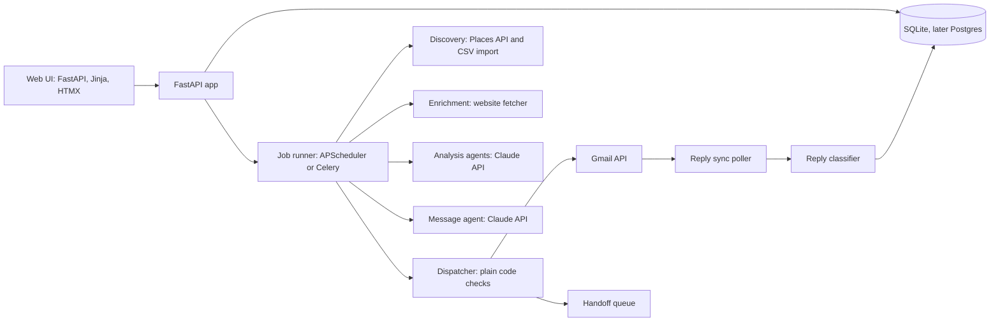

# BUILD_SPEC.md: Proof-First Client Outreach System (Video Editor)

> **How to use this file.** Put it in the root of an empty repo, run `claude` (Claude Code) in that folder, and say:
> "Read BUILD_SPEC.md fully. Create CLAUDE.md from section 1. Then implement Phase 0 only, with tests, and stop for my review."
> Build one phase at a time. Commit after each phase.

---

## 0. Product in one paragraph

A single-user tool for a freelance video editor. It finds prospects (medspas, clinics, realtors, creators, agencies), researches each one from **public, legitimately obtained information**, stores every observation as **evidence with a source**, writes a **different, evidence-grounded message per prospect**, attaches the **correct portfolio link**, and sends it through the **only channel allowed for that prospect**. A human approves every first message. Replies are tracked, classified and answered with drafts. The goal is paying clients, not volume: 10 to 40 researched messages per day.

## 1. Non-negotiable rules (copy into CLAUDE.md)

1. **No scraping of Instagram, LinkedIn, Facebook or X.** No logged-in automation, no cookies or session tokens, no fake accounts, no CAPTCHA or rate-limit bypass, no browser-fingerprint tricks, no unofficial "API" vendors.
2. **Social analysis is human-fed.** The user supplies a public profile URL plus pasted bio/captions and screenshots of public posts. Claude analyses what was supplied. See section 5.
3. **Automated sending exists for email only**, through official Gmail (or Microsoft) OAuth from the user's own mailbox. Instagram, LinkedIn, Facebook, X, WhatsApp are **handoff channels**: the app prepares the message and portfolio link, the human pastes and sends.
4. **Every personalised claim must cite an evidence row.** No evidence, no claim. No invented compliments, no fake familiarity.
5. **Compliance logic is plain code, never an LLM:** suppression check, daily cap, per-organisation contact lock (90 days), unsubscribe handling, send window.
6. **Approval required** for every initial message and every follow-up (default, configurable only for replies in an existing thread).
7. **Default `SEND_ENABLED=false`** (dry run). Real sending needs explicit config.
8. **Never store passwords, cookies or raw tokens in plaintext.** OAuth tokens encrypted at rest (Fernet key from env). Secrets only in `.env` (git-ignored).
9. **Any opt-out, "not interested", "stop", "unsubscribe" in any language adds the contact and its organisation to suppression immediately** (keyword rule first, LLM second).
10. Do not contact EU/UK-based recipients in the MVP unless `ALLOW_EU_UK=true`.
11. Medical niche: never make or suggest health, outcome or before/after claims in outreach copy; only talk about editing craft.

## 2. Channel capability matrix (what the code must respect)

| Channel | Discover | Analyse | Send | Implementation |
|---|---|---|---|---|
| Google Places API | Yes | n/a | n/a | Official API, billing enabled, key restricted |
| Business websites | Yes | Yes | n/a | Polite fetch, robots.txt, identifiable user agent |
| Email | n/a | n/a | **Yes, after approval** | Gmail API OAuth, caps, unsubscribe |
| Instagram | No general search API (Business Discovery and hashtag APIs are narrow, need review; not used in MVP) | Human-fed (URL, text, screenshots) | **Handoff only** | Copy message + open profile link + mark sent |
| LinkedIn | No | Human-fed | **Handoff only** | Same |
| Facebook Pages | No | Human-fed | **Handoff only** | Same |
| X | No | Human-fed | **Handoff only** | Same |
| YouTube | Optional Data API (metadata) | Yes (public metadata, user-supplied URL) | No | Phase 6 |
| Instagram/Messenger inbound | n/a | n/a | Reply only to people who messaged first (24h window) | Phase 6, needs Meta app review |

## 3. Architecture



### Stack decisions

- **Python 3.12 + FastAPI + SQLModel/SQLAlchemy + Alembic.** Best fit for fetching, parsing and LLM work.
- **SQLite for Phase 0 to 4**, schema written to be Postgres-compatible. Move to Postgres when you outgrow it.
- **UI: server-rendered Jinja templates + HTMX + Tailwind (CDN) at first.** One person uses this; a separate React app is not worth the cost yet.
- **Jobs: APScheduler in-process for the MVP** (run exactly one app worker so jobs do not run twice; enable SQLite WAL mode); Celery + Redis only if needed later.
- **LLM: Anthropic Python SDK** behind a thin `llm.py` wrapper (retries, timeouts, JSON validation with Pydantic, cost logging, prompt caching where useful).
- **No vector database.** No n8n.
- **Libraries:** `httpx`, `selectolax` or `beautifulsoup4`, `tldextract`, `rapidfuzz`, `pydantic`, `cryptography`, `google-auth-oauthlib`, `google-api-python-client`, `apscheduler`, `pytest`.

### Model routing

| Task | Model | Notes |
|---|---|---|
| Screenshot/caption analysis, qualification judgement, final message | `claude-opus-5-5` | Judgement and copy quality; low volume |
| Bulk website text extraction, tagging | `claude-sonnet-5-5` | Cheaper structured extraction |
| Reply classification, language detection | `claude-haiku-5-5` | Cheap, fast; keyword rules override |

Models are configured in `.env` (`MODEL_JUDGE`, `MODEL_EXTRACT`, `MODEL_CLASSIFY`) so they can be changed without code changes. Log tokens and estimated cost per call; enforce `MONTHLY_LLM_BUDGET_INR` as a hard stop.

## 4. Data model (SQL)

```sql
CREATE TABLE niches (
  id INTEGER PRIMARY KEY, slug TEXT UNIQUE, name TEXT,
  config_json TEXT   -- search_queries, rubric, playbook, portfolio_tags, banned_claims
);

CREATE TABLE organizations (
  id INTEGER PRIMARY KEY, name TEXT, domain_norm TEXT, city TEXT, country TEXT,
  google_place_id TEXT UNIQUE, last_contacted_at TIMESTAMP, contact_locked_until TIMESTAMP
);

CREATE TABLE leads (
  id INTEGER PRIMARY KEY, organization_id INTEGER REFERENCES organizations(id),
  niche_id INTEGER REFERENCES niches(id),
  contact_name TEXT, contact_role TEXT, website TEXT, description TEXT,
  size_band TEXT, quality_score REAL, fit_reason TEXT,
  status TEXT NOT NULL DEFAULT 'NEW',
  source TEXT, intent_signal TEXT, created_at TIMESTAMP, updated_at TIMESTAMP
);

CREATE TABLE contact_points (
  id INTEGER PRIMARY KEY, lead_id INTEGER REFERENCES leads(id),
  type TEXT,           -- email, phone, instagram, linkedin, facebook, x, youtube, website
  value_raw TEXT, value_norm TEXT, source_url TEXT,
  is_public_business_contact INTEGER DEFAULT 1,
  UNIQUE(type, value_norm)
);

CREATE TABLE evidence (
  id INTEGER PRIMARY KEY, lead_id INTEGER REFERENCES leads(id),
  kind TEXT,            -- website_text, caption, bio, screenshot_observation, ad_library, job_post, note
  source_type TEXT,     -- web, pasted_text, screenshot, user_note
  source_url TEXT, source_ref TEXT,   -- e.g. uploaded file name
  snippet TEXT, observed_at TIMESTAMP, confidence REAL
);

CREATE TABLE portfolio_assets (
  id INTEGER PRIMARY KEY, niche_id INTEGER REFERENCES niches(id),
  title TEXT, url TEXT, type TEXT,   -- main, reel, cinematic, before_after, testimonial
  tags TEXT, active INTEGER DEFAULT 1
);

CREATE TABLE messages (
  id INTEGER PRIMARY KEY, lead_id INTEGER REFERENCES leads(id),
  channel TEXT, kind TEXT,           -- initial, followup, reply
  draft_a TEXT, draft_b TEXT, body TEXT, subject TEXT,
  portfolio_asset_id INTEGER REFERENCES portfolio_assets(id),
  status TEXT,                       -- DRAFT, APPROVAL_PENDING, APPROVED, SENT, MANUAL_PENDING, SENT_MANUAL, FAILED, REJECTED
  approved_at TIMESTAMP, sent_at TIMESTAMP, provider_message_id TEXT, error TEXT,
  validation_json TEXT
);

CREATE TABLE message_evidence (message_id INTEGER, evidence_id INTEGER, PRIMARY KEY(message_id, evidence_id));

CREATE TABLE interactions (
  id INTEGER PRIMARY KEY, lead_id INTEGER REFERENCES leads(id),
  channel TEXT, direction TEXT,      -- out, in
  body TEXT, classification TEXT, occurred_at TIMESTAMP, raw_ref TEXT
);

CREATE TABLE suppressions (
  id INTEGER PRIMARY KEY, type TEXT, value_hash TEXT, reason TEXT, created_at TIMESTAMP,
  UNIQUE(type, value_hash)           -- SHA-256 of normalized email, domain or handle; never deleted on erasure
);

CREATE TABLE settings (key TEXT PRIMARY KEY, value TEXT);  -- rates, packages, tone, caps, send window
CREATE TABLE audit_log (id INTEGER PRIMARY KEY, actor TEXT, action TEXT, entity TEXT, entity_id INTEGER, detail_json TEXT, ts TIMESTAMP);
CREATE TABLE llm_calls (id INTEGER PRIMARY KEY, task TEXT, model TEXT, input_tokens INTEGER, output_tokens INTEGER, est_cost_inr REAL, ts TIMESTAMP);
```

Indexes: `leads(status, niche_id)`, `organizations(domain_norm)`, trigram or `rapidfuzz`-based name matching in code, `messages(status, channel)`, `interactions(lead_id, occurred_at)`, `evidence(lead_id)`.

### Lead status flow

`NEW -> RESEARCHED -> QUALIFIED -> MESSAGE_READY -> APPROVAL_PENDING -> SENT -> REPLIED -> INTERESTED -> MEETING_BOOKED -> CLIENT`
Side states: `NOT_A_FIT`, `NOT_INTERESTED`, `FAILED`, `BLOCKED`, `DO_NOT_CONTACT` (any state to `BLOCKED`/`DO_NOT_CONTACT`). Any inbound reply cancels scheduled follow-ups.

### Duplicate prevention (layered, in code)

1. Exact: `google_place_id`, normalised domain (strip `www`, tracking params), lowercase email, E.164 phone, canonical social handle.
2. Fuzzy: `rapidfuzz` name similarity in the same city, flagged for review rather than auto-merged.
3. Organisation lock: one person per organisation per 90 days unless the user overrides.
4. Cross-channel: dispatcher refuses to send if any interaction with the organisation is within the cooldown, on any channel.

## 5. Social profile analysis (Instagram, LinkedIn, Facebook, X) without scraping

This is the **Public Profile Intake** feature. It makes Claude analyse social presence without any prohibited automation.

**Intake form per lead (UI):**
- Platform and public profile URL (stored as a contact point).
- Paste: bio text, last 5 to 15 captions, any visible posting dates or frequency notes.
- Upload: up to 8 screenshots of public posts, reels thumbnails, highlights or profile pages (PNG/JPG).
- Optional: public reel or video URLs (stored only as links), plus a one-line user note ("reel at 0:12 has no captions").

**Processing (Opus, vision):**
1. Each screenshot and text block is sent to `MODEL_JUDGE` with the schema below.
2. Output is a list of observations. Each becomes an `evidence` row with `source_type=screenshot|pasted_text` and `source_ref` pointing to the file or text block.
3. Observations must be **descriptive and checkable** ("captions appear in a single plain font; first 2 seconds show no on-screen hook"), never speculative about private facts or health outcomes.
4. The analysis also returns: content types seen, posting cadence (only if dates supplied), visual style, brand consistency, and 2 to 4 concrete editing opportunities, each linked to evidence IDs.

**Observation schema (Pydantic):**
```json
{
  "observations": [
    {"text": "string", "kind": "style|cadence|format|captioning|hook|branding|audio|other",
     "evidence_ref": "screenshot:3 | caption:2 | bio",
     "confidence": 0.0}
  ],
  "opportunities": [{"idea": "string", "supports": ["observation index"]}],
  "unknown": ["things that could not be determined from the supplied material"]
}
```

**Privacy rules for uploads:** do not upload screenshots that show patients, minors, identifiable before/after body or face images, medical records or any health information. Crop them out or describe the post in text instead. The analysis agent must refuse to describe individuals in images beyond generic content type ("a treatment-room clip") and must never infer medical conditions. Screenshots go to the Anthropic API for analysis, so treat them as data you are sharing with a processor and mention that in your privacy notes.

**Rules:** if the material is insufficient the agent returns `unknown` and the lead cannot reach `MESSAGE_READY` until the user supplies more. Screenshots are stored locally, deleted after `RAW_RETENTION_DAYS` (default 30).

LinkedIn works the same way: the user pastes the public headline/about/recent public posts or uploads screenshots. For decision-maker discovery, the user pastes names and roles from the company website's team page or public LinkedIn view; the app never queries LinkedIn.

## 6. Pipelines

### 6.1 Discovery
1. Input: niche, city, radius, max results (or CSV import of leads from Meta Ad Library, job posts, directories).
2. Places API Text Search with a **minimal field mask** first (id, name, location, category); fetch contact fields only for leads passing a cheap filter.
3. Normalise, dedup, create `organizations` + `leads` (`NEW`), store `intent_signal` if the lead came from an intent source (ads running, hiring editor, new clinic, etc.).
4. **Google Places data rule (verified: only `place_id` is exempt from caching limits; other Places content has caching and use restrictions under the Maps Platform terms).** Persist `google_place_id` only. Treat name, phone, website, address and coordinates from Places as transient: use them in-session to find the business's own website, then store contact details only from the business's own public website (as evidence with its URL). Re-fetch Places details by `place_id` when needed. Before Phase 1, read the current Google Maps Platform Service Specific Terms (Places caching table) and confirm that your use case (building a prospect list) is allowed. If it is not, drop Places discovery and use CSV import, directories you are licensed to use, and manual research.
5. **Meta Ad Library and job boards are manual sources.** The user browses them by hand and pastes names/URLs into the CSV import. Do not scrape them. Meta's Ad Library API does not reliably cover commercial ads in every country (verify for your target country); never build a scraper around the website.

### 6.2 Website enrichment
- Fetch homepage, about, contact, team pages with an identifiable user agent, robots.txt respected, 1 request per 2 seconds per domain, max 8 pages per site.
- Deterministic extraction first (emails via regex limited to public pages, phones, social links, schema.org data).
- `MODEL_EXTRACT` summarises: category, services, audience, tone, team roles, evidence snippets (stored as `evidence`).

### 6.3 Qualification
- Rubric from `niches.config_json`; deterministic score (niche match, location, contactability, visible video activity, intent signal) plus Opus judgement producing `fit_reason`.
- Output `quality_score` 0 to 100 and a go/no-go. Below threshold -> `NOT_A_FIT`.

### 6.4 Message generation
Inputs: lead, evidence list, niche playbook, tone settings, channel, selected portfolio asset, user's package/rates (for later replies).
1. Opus generates **two drafts** in strict JSON, each listing the `evidence_ids` it relies on.
2. A deterministic validator checks: every claim maps to evidence; length limits (email 70 to 120 words, DM 40 to 80); portfolio URL present and matches the selected asset; banned phrases ("I hope this finds you well", "game-changer", "guaranteed"); no health or outcome claims for medical niche; exactly one clear, low-pressure call to action.
3. A second Opus call scores both drafts against the rubric (specificity, naturalness, no flattery without evidence) and selects one.
4. Store draft_a, draft_b, selected body and `validation_json`; set `APPROVAL_PENDING`.
5. For handoff channels, the message is shaped for that platform (shorter, no formal subject).

**Message style rules (put in system prompt):** natural, concise, first person singular, one specific observed detail, one concrete offer, no fake compliments, no manufactured urgency, no "I noticed your content is bad". Offer a sample re-edit only if the user's settings say sample offers are enabled.

### 6.5 Portfolio matching (deterministic)
1. Select assets where `niche_id` matches, `active=1`, ordered by tag overlap with the lead's content types (e.g. `reels`, `walkthrough`, `before_after`).
2. If no niche asset, fall back to the `main` asset; never send an irrelevant niche sample.
3. LLM is used only to break ties, and only among already-eligible assets.

### 6.6 Outreach dispatcher (no LLM)
On approval, for each message run in order and fail closed:
1. `SEND_ENABLED` true? Otherwise log dry-run.
2. Contact point or organisation in `suppressions`? Block.
3. Organisation lock or any interaction within cooldown? Block.
4. Channel daily and hourly cap, min gap, send window (user timezone) satisfied?
5. Email: send via Gmail API with a `List-Unsubscribe: <mailto:...>` header (mailto only; one-click web unsubscribe needs a public HTTPS endpoint, which a localhost app does not have) and a visible line telling the recipient to reply "stop" to opt out, sender identity and postal/contact details from settings. Store `provider_message_id`.
6. Handoff channel: set `MANUAL_PENDING`; UI shows **Copy message**, **Open profile** and **Mark as sent** buttons; on mark, set `SENT_MANUAL` and create an outbound interaction.
7. Write audit log entry.

### 6.7 Reply handling
- Gmail poller (every 5 minutes) reads replies in threads started by the app; manual replies are logged by pasting text into **Log reply**.
- Classifier (`MODEL_CLASSIFY`) labels: `SEND_WORK`, `PRICING`, `PACKAGE`, `INTERESTED`, `NOT_INTERESTED`, `UNSUBSCRIBE`, `OUT_OF_OFFICE`, `QUESTION`, `OTHER`.
- **Keyword override before LLM:** `stop`, `unsubscribe`, `remove me`, `don't contact`, `not interested`, and common Hindi/Hinglish equivalents -> suppression + `NOT_INTERESTED`/`DO_NOT_CONTACT` immediately.
- Draft reply (Opus) using settings: portfolio, rates, packages. Pricing replies only use values in `settings`; if missing, draft asks the user to fill them rather than invent numbers.
- Every reply draft goes to approval.

### 6.8 Follow-ups
- At most 2 follow-ups, spaced by configurable gaps (default 4 and 9 days), only on channels allowed (email auto-scheduled; handoff channels appear as reminders), only if no reply, not suppressed, caps respected.
- Each follow-up adds something new (a different observation, a short sample idea) and is generated and approved like a first message. Never repeat the same text.

## 7. API (REST, JSON; session auth for UI)

| Method | Path | Purpose |
|---|---|---|
| POST | /api/v1/discovery/jobs | Start Places discovery (niche, city, radius, limit) |
| POST | /api/v1/leads/import | Import CSV of leads with `intent_signal` |
| GET | /api/v1/leads | Filter by niche, country, city, status, quality, platform |
| GET | /api/v1/leads/{id} | Lead + evidence + messages + interactions |
| POST | /api/v1/leads/{id}/enrich | Re-run website enrichment |
| POST | /api/v1/leads/{id}/intake | Public Profile Intake (text + screenshots, multipart) |
| POST | /api/v1/leads/{id}/qualify | Run qualification |
| POST | /api/v1/leads/{id}/messages/generate | Generate drafts for a channel |
| GET | /api/v1/approvals | Pending approvals |
| POST | /api/v1/messages/{id}/approve / reject / edit | Approval actions |
| POST | /api/v1/messages/{id}/mark-sent-manually | Handoff completion |
| POST | /api/v1/interactions/manual | Paste a reply received outside email |
| GET/POST/PATCH | /api/v1/portfolio | Manage portfolio assets |
| GET/PUT | /api/v1/settings | Tone, rates, packages, caps, windows |
| POST | /api/v1/suppressions | Add do-not-contact |
| GET | /api/v1/analytics/funnel | Funnel by niche, channel, source |
| POST | /api/v1/integrations/google/connect | Gmail OAuth flow |
| GET | /healthz | Health |

Example approve error:
```json
409 {"error": "ORG_LOCKED", "detail": "Organisation contacted 12 days ago by email", "locked_until": "2026-12-20"}
```

## 8. UI (build in this order)

1. **Approval Queue** (most important): lead summary, evidence chips with source links, draft A/B, edit box, portfolio link preview, warnings (duplicate, suppression, cap), Approve / Edit / Reject.
2. **Lead Detail**: evidence list, intake form (paste + screenshots), qualification, history.
3. **Discovery**: niche/city form, job progress, CSV import.
4. **Handoff Queue**: Copy message, Open profile, Mark sent.
5. **Inbox**: replies, classification, suggested response draft.
6. **Portfolio Manager**, **Settings** (rates, packages, tone, caps, windows, retention), **Funnel** (sent, replied, positive, calls, paid).

Keep the first release to screens 1 to 4 plus Settings.

## 9. Prompts (store in `prompts/` as versioned files)

**analysis_system.md**
> You analyse public social-media material supplied by a video editor. Describe only what is visible or written in the supplied material. Do not infer private facts, health results, or business performance. If the material is insufficient, say so under `unknown`. Output JSON matching the schema. Every observation must reference its source (`screenshot:N`, `caption:N`, `bio`).

**message_system.md**
> You write one outreach message from a freelance video editor to a business owner. Use ONLY the supplied evidence. Each factual claim must cite evidence IDs. Tone: natural, concise, respectful, no flattery that isn't supported, no urgency tricks. One specific observation, one concrete offer, the provided portfolio link, one low-pressure question. Medical niche: no claims about treatments, results or patient outcomes. Output two drafts as JSON with `evidence_ids`.

**reply_system.md**
> Classify the reply and draft a response. Use only the supplied rates and packages. If a needed value is missing, return `needs_user_input` instead of inventing it. Never push after a decline.

## 10. Security and compliance

- `.env` for keys; `.env.example` committed with placeholders. Keys never logged.
- Gmail OAuth caveats: a Google Cloud OAuth app in "Testing" status issues refresh tokens that expire after 7 days. For personal use either re-authorise weekly, use a Workspace account with an "Internal" app, or complete Google's verification (`gmail.readonly` is a restricted scope and verification can be heavy). Prefer `gmail.send` plus reading only your own app-sent threads, or use IMAP with an app-specific password stored encrypted if OAuth friction is too high. Plan this in Phase 4.
- Google OAuth scopes minimal: `gmail.send`, `gmail.readonly` (or `gmail.modify` only if labels needed). Store refresh token encrypted (Fernet).
- Session-protected UI (password hashed with argon2, or Google sign-in) even though it is single-user; bind to localhost until deployed behind HTTPS.
- Audit log on approvals, sends, status changes, suppression edits.
- Retention: raw HTML/screenshots 30 days; evidence and history 12 months after last activity; suppression hashes retained.
- India DPDP: the Rules were notified in November 2025 with phased commencement; main obligations expected around May 2027. Build now for: notice text in the first email (who you are, why you are writing, how to opt out), data minimisation, working opt-out, erasure on request (except suppression hashes), breach log. Have an Indian privacy lawyer review the notice text.
- GDPR/UK: excluded by default (`ALLOW_EU_UK=false`).
- US recipients: CAN-SPAM basics (accurate sender, non-deceptive subject, postal address, working opt-out within 10 business days).
- Respect each platform's terms. This is not legal advice.

## 11. Testing requirements

- Unit tests: URL/email/phone/handle normalisation, dedup, organisation lock, suppression (including hashed lookup), daily caps, send-window logic, keyword opt-out detection (English + Hinglish), claim validator, portfolio matcher.
- Integration tests with mocked Places, Gmail and Anthropic clients.
- **Golden evaluation set:** 30 real or realistic leads with evidence; run message generation and measure: unsupported-claim rate (target < 2%), banned-phrase rate (0%), average human rating of drafts.
- Dry-run end-to-end test must pass before `SEND_ENABLED=true`.
- Deliverability checklist before first real send: SPF, DKIM, DMARC set on the sending domain; test emails to your own addresses; warm up with 5 to 10 per day.

## 12. Phases and acceptance criteria

| Phase | Build | Done when |
|---|---|---|
| 0 | Repo, config, schema + migrations, auth, audit log, suppression, LLM wrapper with cost logging, tests | `pytest` green; dedup and suppression tests pass |
| 1 | CSV import, Places discovery, website enrichment, evidence store, qualification | 30 real leads imported and enriched with sourced evidence |
| 2 | Public Profile Intake (text + screenshots), analysis agent | A pasted profile + 5 screenshots yields cited observations |
| 3 | Portfolio manager + matcher, message generation, validator, approval queue UI | Golden set: < 2% unsupported claims; you approve at least 70% of drafts with light edits |
| 4 | Gmail OAuth, dispatcher with caps/locks/unsubscribe, handoff queue, reply sync and classifier, inbox | Dry run then 5 real sends to yourself; reply correctly classified and suppression works |
| 5 | Follow-up manager, pricing/package reply drafts, funnel analytics | Follow-ups never fire after a reply or opt-out (tested) |
| 6 (optional) | Inbound Instagram/Messenger automation (people who messaged first), YouTube metadata, extra niches | Meta app review approved |

## 13. Configuration (`.env.example`)

```
ANTHROPIC_API_KEY=
MODEL_JUDGE=claude-opus-5-5
MODEL_EXTRACT=claude-sonnet-5-5
MODEL_CLASSIFY=claude-haiku-5-5
MONTHLY_LLM_BUDGET_INR=5000
GOOGLE_PLACES_API_KEY=
GOOGLE_OAUTH_CLIENT_ID=
GOOGLE_OAUTH_CLIENT_SECRET=
FERNET_KEY=
SEND_ENABLED=false
ALLOW_EU_UK=false
DAILY_CAP_EMAIL=15
CONTACT_LOCK_DAYS=90
RAW_RETENTION_DAYS=30
SEND_WINDOW=10:00-18:00
TIMEZONE=Asia/Kolkata
SENDER_NAME=
SENDER_CONTACT_ADDRESS=
```

## 14. Proof-first offer settings (configure before use)

Fill these in `settings` before generating messages:
- Niche focus and country to start (one niche first).
- Productised package(s), e.g. "8 short-form reels per month, 48h turnaround, 1 revision" with price.
- Portfolio assets per niche (3 to 5 best pieces each) and one `main` link.
- Whether to offer a free 20 to 40 second sample re-edit of one of their **own public** videos. It is their footage: send privately only, never post or reuse it, say so in the message, delete on request, and skip it for any footage featuring patients or minors.
- Tone: Hinglish/English, formal or friendly.

## 15. Instructions to Claude Code for the first session

1. Read this whole file. Create `CLAUDE.md` containing section 1, section 2, the model routing table and the testing rules.
2. Create the repo structure: `app/` (api, models, services, agents, prompts, ui), `tests/`, `alembic/`, `.env.example`, `README.md`.
3. Implement **Phase 0 only**. Write tests first for suppression, dedup, caps and organisation lock.
4. Run the tests, show results, commit, and stop. Do not start Phase 1 until the user approves.
5. If any instruction conflicts with a platform's terms, or if a feature would require scraping or session automation, do not implement it. Propose the compliant handoff alternative instead.
